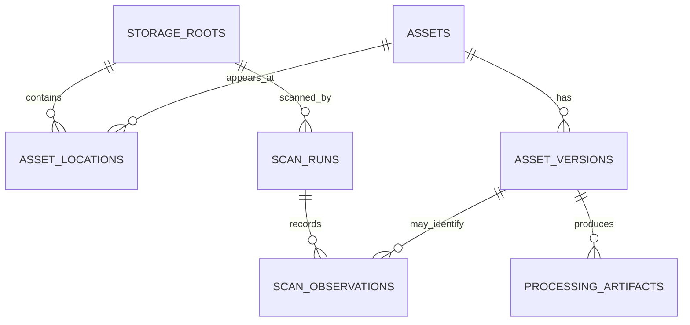

# Registry Data Model Proposal

**Status:** initial relational contract implemented in `infrastructure/postgres/migrations/0001_asset_registry.sql`; review and integration testing continue.

The first domain models are persistence-agnostic. This document proposes the minimum relational records needed to preserve identity, location, scan history, and derived-artifact provenance without storing or modifying original files.

## Proposed entities

| Entity | Purpose | Important constraints |
|---|---|---|
| `storage_roots` | Logical storage sources | Stable root ID; no credentials in URI; enabled/disabled state |
| `assets` | Logical file identity | Stable asset ID independent of path |
| `asset_versions` | Immutable content versions | Unique content digest + size within asset; never overwrite an old version |
| `asset_locations` | Paths under roots | Unique normalized path key per root; availability is explicit |
| `scan_runs` | One discovery attempt | Root ID, start/end time, status, scanner version |
| `scan_observations` | What a scan actually saw | Tied to scan ID; includes entry kind and relative path |
| `processing_artifacts` | Extracted text, summaries, embeddings, etc. | Tied to asset version and processor/model version |
| `audit_events` | Access and policy decisions | No document bodies or secrets in event payloads |

## Relationship sketch

## Required semantics

1. A path is not an asset identity. Moving a file must not create a new logical asset merely because its path changed.
2. A new content digest creates a new immutable version.
3. A scan may set a location to MISSING only after a COMPLETE scan of that same root.
4. PARTIAL, FAILED, CANCELLED, or unavailable-root scans must never mark unseen locations missing.
5. A location's availability is separate from asset existence.
6. Derived artifacts are reproducible caches, not authoritative source data.
7. Every derived artifact records source version, processor/version, model identifier where applicable, and creation time.
8. Deletion from the source filesystem is represented as a lifecycle event/tombstone, not destructive removal of historical records.

## Path normalization

Do not assume one global path normalization rule. Windows, Linux, macOS, NAS, and removable filesystems can differ in case sensitivity and Unicode behavior.

The schema should preserve:
- original observed relative path;
- normalized comparison key;
- normalization algorithm/version;
- root-specific case-sensitivity policy, if known.

Do not collapse two locations solely because their normalized strings match under an unverified policy.

## Open design questions

- Should assets be deduplicated globally by content hash or only within a storage trust boundary?
- Should asset IDs be random UUIDs or deterministic IDs derived from content?
- How should hard links, sparse files, cloud placeholders, and filesystem snapshots be represented?
- Which metadata belongs in the primary database versus a rebuildable sidecar?
- Should scan observations be retained permanently or compacted after reconciliation?

PostgreSQL is the initial persistence target. The domain remains ORM-independent; the SQL migration is the executable contract. See [the schema implementation notes](registry-schema.md).
